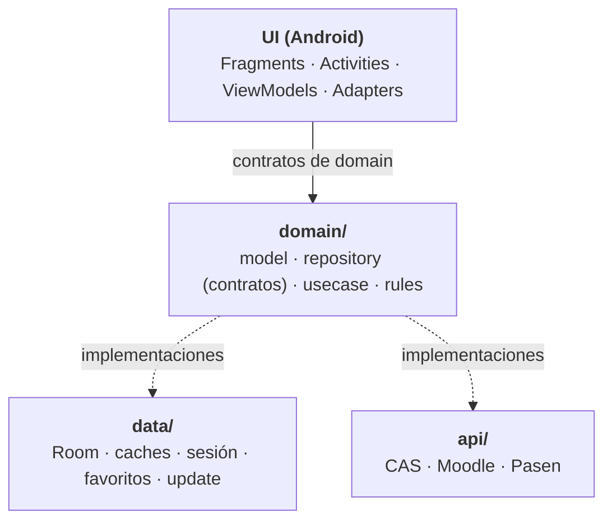

# iMoodle

> Cliente Android **no oficial** para consultar **Moodle Centros** e **iPasen** con una sola sesión, pensado para alumnado de la Junta de Andalucía.

[](https://kotlinlang.org)
[](https://developer.android.com)
[](./app/build.gradle.kts)
[]()

---

## 📱 ¿Qué es iMoodle?

iMoodle es una aplicación Android **personal y no oficial** que unifica en una sola app los dos servicios que más usa el alumnado andaluz:

- **Moodle Centros**: cursos, tareas, foros, archivos y calendario.
- **iPasen**: horario semanal y datos personales del alumno.

Una sola sesión de la Junta de Andalucía (IdEA / CAS) autentica contra ambos servicios. La app está pensada para **uso personal**, no se distribuye en Play Store y no está afiliada a la Junta de Andalucía.

> ⚠️ **Aviso**: la app usa las APIs de Moodle e iPasen en nombre del propio usuario. Algunas de esas APIs no están documentadas oficialmente (Pasen) y podrían cambiar sin previo aviso. Úsala bajo tu responsabilidad.

---

## ✨ Funcionalidades

### Moodle
- 🔐 Login con credenciales de la Junta (CAS + Moodle).
- 📚 Listado de cursos con progreso y portada (o patrón generado si no hay).
- ⭐ **Cursos favoritos**: marca tus asignaturas con una estrella para que aparezcan siempre las primeras en la lista. Se guardan en local, así que funcionan incluso sin red.
- 📂 Detalle de curso con secciones, módulos y archivos descargables.
- 📝 Detalle de tarea con fechas, estado de entrega, nota y adjuntos.
- 💬 Foros con discusiones y mensajes en HTML (enlaces clicables).
- 📅 Agenda de los próximos 30 días con eventos del calendario.

### iPasen
- 🗓️ **Horario semanal** con colores únicos por asignatura y filtro por día.
- 👤 **Perfil del alumno** enriquecido con datos personales (centro, fecha de nacimiento, edad, sexo).

### General
- 👆 **Navegación por gestos**: desliza el dedo entre las pestañas de Cursos, Agenda, Horario y Perfil (en orientación vertical; desactivada en horizontal).
- ⬅️ **Botón "atrás" del sistema** integrado con la navegación por gestos: nunca deja la pantalla en blanco al volver desde un detalle.
- 🔄 **Actualizador interno**: la app te avisa de nuevas versiones, descarga el APK directamente desde GitHub y lo instala sin salir de la app (usa `FileProvider` + el instalador nativo de Android).
- 📝 **Changelog en Markdown**: el diálogo de actualización renderiza el changelog del Release formateado (vía `Markwon`), igual que en GitHub.
- 🔔 **Notificaciones locales** de tareas próximas a entregar (Regla de medianoche + Regla de oro, con soporte de DST).
- 🔄 **Refresco silencioso de tokens**: la sesión se renueva sin pedir la contraseña.
- 💾 **Offline-first**: cursos, tareas y calendario se cachean en local.
- ⚡ **Caché por usuario** de horario y perfil: solo se llama a Pasen la primera vez o al hacer *pull-to-refresh*.
- 🌓 **Tema claro/oscuro** (Material 3 DayNight).

---

## 📸 Capturas

> Descubre la interfaz por ti mismo. No te lo voy a dar todo en bandeja.

---

## 🏗️ Arquitectura

El proyecto sigue **Clean Architecture** con **MVVM** en la capa de UI.



- **`domain/`**: contratos de negocio (modelos, repositorios, casos de uso). No depende de Android.
- **`data/`**: implementaciones de persistencia local (Room, `SharedPreferences`), gestión de sesión, favoritos y actualizador.
- **`api/`**: clientes HTTP de los proveedores (CAS, Moodle, Pasen). Un paquete por proveedor.
- **`ui/`**: pantallas, ViewModels, adapters y utilidades de UI (incluido el diálogo de actualización y el instalador de APK).
- **`inyectores/`**: módulos de Hilt.
- **`notifications/`**: programación de recordatorios con `AlarmManager`.
- **`core/`**: utilidades transversales.

---

## 🛠️ Stack técnico

| Categoría | Tecnología |
|---|---|
| Lenguaje | Kotlin 2.x |
| UI | Material 3 · ViewBinding · ViewPager2 |
| Arquitectura | MVVM + Clean Architecture |
| Inyección de dependencias | Hilt |
| Persistencia local | Room + `SharedPreferences` cifradas |
| Red | OkHttp 4.12 |
| Concurrencia | Coroutines + Flow |
| Imágenes | Coil (con `SvgDecoder` para patrones generados) |
| Markdown | Markwon (changelog de actualizaciones) |
| Actualizaciones | FileProvider · Package Installer (`Intent.ACTION_VIEW`) |
| Seguridad | Jetpack Security (`EncryptedSharedPreferences` + Android Keystore) |
| Tests | JUnit 4 · MockK · Turbine |
| Build | Gradle 9.6 · AGP 9.4.1 |

---

## ✅ Requisitos

- **Android Studio** reciente (Ladybug o superior recomendado).
- **JDK 17**.
- Dispositivo o emulador con **Android 9 (API 28)** o superior.
- **Cuenta de la Junta de Andalucía (IdEA)** válida: la app no crea cuentas, solo usa las del usuario.

---

## 🚀 Compilar y ejecutar

```bash
# 1. Clona el repositorio
git clone https://github.com/gh0st-2202/iMoodle.git
cd iMoodle

# 2. Compila
./gradlew :app:assembleDebug

# 3. Ejecuta los tests unitarios
./gradlew :app:testDebugUnitTest
```

También puedes abrir el proyecto en Android Studio y usar **Run ▶︎** como con cualquier proyecto Android.

> La app no se publica en Play Store. El APK generado es para uso personal.
>
> **Nota sobre actualizaciones**: para que el actualizador interno instale una nueva versión, el APK debe estar firmado con **el mismo keystore** que la versión ya instalada en el dispositivo. Android rechaza la actualización si las firmas no coinciden.

---

## 🔒 Privacidad y seguridad

La app maneja datos sensibles, así que conviene explicar cómo se tratan:

- **Credenciales de la Junta**: se guardan **cifradas** en el dispositivo con `EncryptedSharedPreferences` + **Android Keystore**. Se borran al hacer logout o si la Junta las rechaza.
- **Tokens de Moodle**: se guardan cifrados. Son revocables y de corta duración.
- **Cachés de horario y perfil**: se indexan por `username` de la Junta, en `SharedPreferences`. No contienen credenciales.
- **Cursos favoritos**: se guardan **solo en el dispositivo** (`SharedPreferences`), sin enviar datos a ningún servidor externo.
- **Datos de cursos, tareas y calendario**: se guardan en Room y se borran al hacer logout.
- **Actualizaciones**: el APK descargado se guarda temporalmente en `cacheDir` y se instala mediante `FileProvider` + el instalador nativo de Android. Solo se descarga desde el repositorio oficial de GitHub del proyecto.
- **Sin telemetría**: la app no envía datos a ningún servidor propio. Todas las peticiones van directamente a los servidores de la Junta.
- **Sin publicidad**: no hay SDKs de terceros que rastreen al usuario.

Si detectas una vulnerabilidad, abre un *issue* describiéndola sin incluir datos reales.

---

## 📁 Estructura del proyecto (resumen)

```
app/src/main/java/onion/gh0st/iMoodle/
├── api/              Clientes de CAS, Moodle y Pasen
│   ├── cas/
│   ├── moodle/
│   └── pasen/
├── core/             Utilidades transversales (logging, await, defaults…)
├── data/             Persistencia y gestión de sesión
│   ├── auth/         Almacenes cifrados (tokens, credenciales)
│   ├── favourites/   Almacenamiento local de cursos favoritos (SharedPreferences)
│   ├── local/        Room (DAOs, entidades, migraciones)
│   ├── schedule/     Caché de horario por usuario
│   ├── session/      Sesión, caché de usuario y perfil
│   └── update/       Actualizador de GitHub, descarga y verificación del APK
├── domain/           Contratos de negocio
│   ├── model/        Modelos (incluye update/AppUpdate)
│   ├── repository/   Contratos de repositorios (incluye update/)
│   ├── rules/
│   └── usecase/      Casos de uso (incluye course/ y update/)
├── inyectores/       Módulos de Hilt
├── notifications/    Recordatorios con AlarmManager
└── ui/               Pantallas, ViewModels y adapters
    ├── courses/list/ CourseAdapter con estrella y CoursesViewModel con favoritos
    ├── main/         MainActivity con ViewPager2 y OnBackPressedCallback
    └── update/       ApkInstaller, UpdateDialogHelper y UpdateViewModel
```

---

## 🤝 Contribuir

Este es un proyecto personal, pero los *issues* y *pull requests* son bienvenidos si:

- 🐛 Encuentras un bug reproducible.
- 💡 Propones una mejora de accesibilidad, rendimiento o UX.
- 📝 Detectas un error en la documentación.

Antes de abrir un PR:

1. Abre un *issue* describiendo qué vas a cambiar y por qué.
2. Respeta el estilo del proyecto: **KDoc completo en clases y métodos**, nombres de variables descriptivos, sin comentarios dentro de los métodos.
3. Ejecuta `./gradlew :app:testDebugUnitTest` antes de enviar.

---

## ⚠️ Disclaimer

Este proyecto **no está afiliado, asociado, autorizado ni respaldado** por la Junta de Andalucía.

- **Moodle Centros** e **iPasen** son servicios oficiales de la Junta de Andalucía.
- La app usa la **API pública de Moodle** (documentada oficialmente) y la **API privada de iPasen** (obtenida mediante ingeniería inversa del tráfico de la app oficial).
- El uso de estas APIs desde aplicaciones de terceros **puede infringir los términos de servicio** de los respectivos servicios. Úsala bajo tu responsabilidad y solo con tu propia cuenta.
- La Junta puede cambiar, cerrar o bloquear estas APIs en cualquier momento. Si eso ocurre, la app podría dejar de funcionar hasta que se adapte.

Este proyecto tiene **fines educativos y personales**: está desarrollado por un estudiante como proyecto de aprendizaje.

---

## 📄 Licencia

Este proyecto se distribuye con fines educativos y de uso personal.

Si quieres reutilizar parte del código en tus propios proyectos, eres libre de hacerlo citando la fuente. Si el repositorio no incluye un archivo `LICENSE`, considera el código bajo la licencia [MIT](https://opensource.org/licenses/MIT) para uso no comercial.

Las marcas **Moodle**, **Moodle Centros**, **iPasen** y **Pasen** pertenecen a sus respectivos titulares.

---

## 🙏 Créditos

- **Moodle** por su API pública de Web Services.
- **Markwon** por el renderizado de Markdown en el changelog.
- **JUnit**, **MockK**, **Turbine**, **Hilt**, **Room**, **OkHttp**, **Coil** y **Jetpack** por las librerías que hacen posible el proyecto.
- La comunidad de desarrolladores Android por la documentación y los ejemplos públicos.

---

<p align="center">
  Hecho con curiosidad, demasiadas horas y amor a la ingeniería inversa por un estudiante de 2º DAM.
</p>
