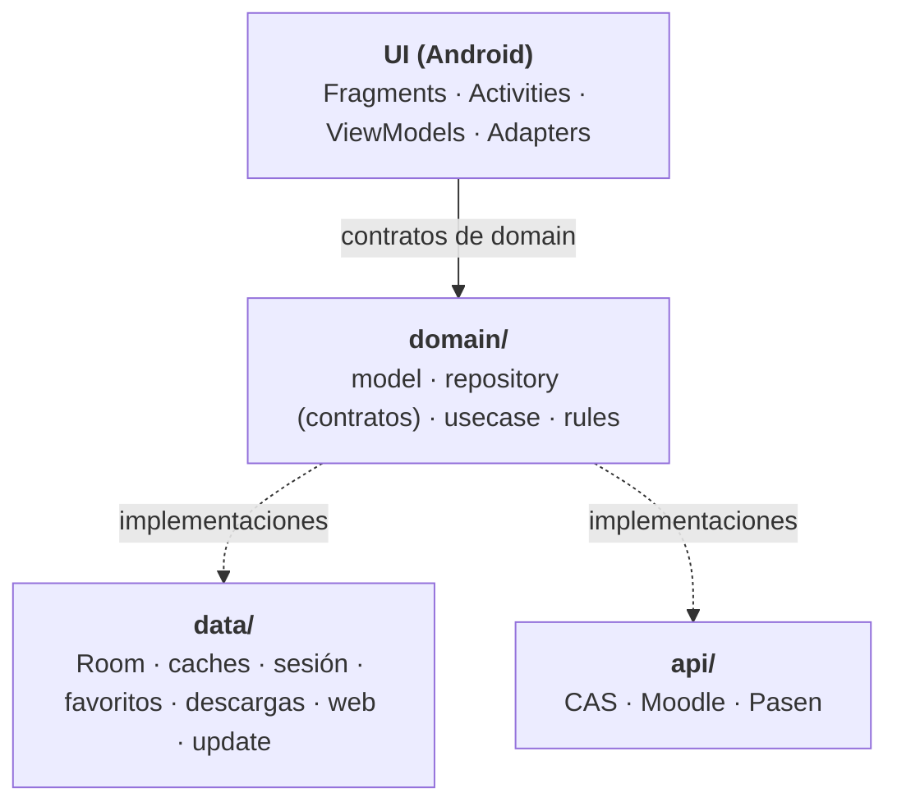

# iMoodle

> Cliente Android **no oficial** para consultar **Moodle Centros** e **iPasen** con una sola sesión, pensado para alumnado de la Junta de Andalucía.

[](https://kotlinlang.org)
[](https://developer.android.com)
[](./app/build.gradle.kts)
[]()

---

## 📱 ¿Qué es iMoodle?

iMoodle es una aplicación Android **personal y no oficial** que unifica en una sola app los dos servicios que más usa el alumnado andaluz:

- **Moodle Centros**: cursos, tareas, foros, archivos y calendario.
- **iPasen**: horario semanal y datos personales del alumno.

Una sola sesión de la Junta de Andalucía (IdEA / CAS) autentica contra ambos servicios. La app está pensada para **uso personal**, no se distribuye en Play Store y no está afiliada a la Junta de Andalucía.

> ⚠️ **Aviso**: la app usa las APIs de Moodle e iPasen en nombre del propio usuario. Algunas de esas APIs no están documentadas oficialmente (Pasen) y podrían cambiar sin previo aviso. Úsala bajo tu responsabilidad.

---

## ✨ Funcionalidades

### Moodle
- 🔐 Login con credenciales de la Junta (CAS + Moodle).
- 📚 Listado de cursos con progreso y portada (o patrón generado si no hay).
- ⭐ **Cursos favoritos**: marca tus asignaturas con una estrella para que aparezcan siempre las primeras en la lista. Se guardan en local, así que funcionan incluso sin red. Un doble toque rápido no deshace el cambio por accidente.
- 🧭 **Listado en horizontal**: al girar el móvil, las asignaturas se muestran como tarjetas deslizables. Cualquier tarjeta visible se puede abrir con un toque (no solo la que queda cortada por el menú lateral), la lista mantiene su posición al marcar favoritos o refrescar y el *pull-to-refresh* sigue funcionando.
- 📂 Detalle de curso con secciones, módulos y archivos descargables.
- 📝 Detalle de tarea con fechas, estado de entrega, nota y adjuntos.
- 💬 Foros con discusiones y mensajes en HTML (enlaces clicables).
- 📖 **Glosarios**: consulta las entradas de un glosario y crea, edita o borra las tuyas. Si Moodle rechaza el cambio (por ejemplo, por permisos), se muestra su motivo.
- 📝 **Wikis**: lee sus páginas y edita su contenido cuando Moodle lo permite, además de crear páginas nuevas. La acción de editar solo aparece si el servidor informa de que tienes permiso.
- 📅 Agenda de los próximos 30 días con eventos del calendario.
- 📤 **Entrega de tareas**: texto en línea y archivos del teléfono, conservando o quitando los ya entregados, con confirmación antes de sustituir una entrega y opción de borrarla. Si Moodle rechaza la entrega (por ejemplo, plazo cerrado) se muestra el motivo.
- 💭 **Comentarios de la entrega**: lee, escribe y borra tus comentarios en el hilo de la tarea.

### iPasen
- 🗓️ **Horario semanal** con colores únicos por asignatura y filtro por día.
- 👤 **Perfil del alumno** enriquecido con datos personales (centro, fecha de nacimiento, edad, sexo), con *pull-to-refresh* que vuelve a consultar iPasen.

### General
- 👆 **Navegación por gestos**: desliza el dedo entre las pestañas de Cursos, Agenda, Horario y Perfil (en orientación vertical; desactivada en horizontal).
- ⬅️ **Botón "atrás" del sistema** integrado con la navegación por gestos: nunca deja la pantalla en blanco al volver desde un detalle.
- 🔄 **Actualizador interno**: la app te avisa de nuevas versiones, descarga el APK directamente desde GitHub y lo instala sin salir de la app (usa `FileProvider` + el instalador nativo de Android). Solo descarga de las *releases* del repositorio oficial y, si la descarga falla, te avisa sin cerrarse.
- 📝 **Changelog en Markdown**: el diálogo de actualización renderiza el changelog del Release formateado (vía `Markwon`), igual que en GitHub.
- 🔔 **Notificaciones locales** de tareas próximas a entregar (Regla de medianoche + Regla de oro, con soporte de DST). El permiso de alarmas exactas se pide una sola vez y, al concederlo, los recordatorios se reprograman sin reiniciar la app; también se recalculan si cambias de hora o de zona horaria.
- 📥 **Descargas**: los archivos van a `Descargas` en Android 10 o superior. En Android 9 se guardan en el almacenamiento propio de la app para que la descarga funcione sin pedir permisos de escritura adicionales.
- 🔄 **Refresco silencioso de tokens**: la sesión se renueva sin pedir la contraseña. Un corte de red o una caída del servidor de la Junta **no** cierran la sesión.
- 💾 **Offline-first**: cursos, tareas y calendario se cachean en local.
- ⚡ **Caché por usuario** de horario y perfil: solo se llama a Pasen la primera vez o al hacer *pull-to-refresh*.
- 🌓 **Tema claro/oscuro** (Material Components DayNight).

---

## 🆕 Novedades de la 2.6

La versión **2.6** cierra la ronda de correcciones que salió de probar la app en un móvil real:

- 📖 **Glosarios y wikis nativos**: leer, crear, editar y borrar entradas del glosario; leer, editar y crear páginas de una wiki (con el formato original intacto y sin el índice ni los enlaces «[Editar]» de la web de Moodle).
- 🔄 **Girar el móvil ya no cierra el detalle**: la tarea, el foro o el curso abiertos siguen en pantalla, también en la pestaña **Cursos**.
- 📅 **Agenda en horizontal**: las tarjetas vuelven a responder al toque y abren la tarea.
- ✏️ **Editar una wiki funciona**: se envía `lockonly` como `0` (los booleanos de Moodle son `1`/`0`) y se omite `section`, así que Moodle ya no responde `invalidparameter`.
- 🔗 **Enlaces en las tareas**: el enunciado conserva sus enlaces pulsables aunque el texto no sea la URL.
- 🧪 **Trazas de red** solo en `debug`, acotadas a los *web services* de Moodle (`adb logcat -s iMoodleNet`), sin el `wstoken`.

---

## 📸 Capturas

> Descubre la interfaz por ti mismo. No te lo voy a dar todo en bandeja.

---

## 🏗️ Arquitectura

El proyecto sigue **Clean Architecture** con **MVVM** en la capa de UI.



- **`domain/`**: contratos de negocio (modelos, repositorios, casos de uso). Kotlin puro: no depende de Android, `api/`, `data/` ni `ui/`.
- **`data/`**: implementaciones de los contratos de dominio: persistencia local (Room, `SharedPreferences`), sesión, favoritos, descargas con `DownloadManager`, sesión web para el `WebView` y actualizador/instalador de APK.
- **`api/`**: clientes HTTP de los proveedores (CAS, Moodle, Pasen). Un paquete por proveedor.
- **`ui/`**: pantallas, ViewModels, adapters y utilidades de vista. Solo importa `domain/`; nunca `data/` ni `api/`.
- **`inyectores/`**: módulos de Hilt.
- **`notifications/`**: programación de recordatorios con `AlarmManager`.
- **`core/`**: utilidades transversales.

Reglas que se respetan en todo el proyecto:

- **`ui/` → `domain/`**: los ViewModels dependen de casos de uso, no de repositorios, y no tienen `Context`; emiten eventos con `@StringRes` y la vista resuelve el texto.
- **`domain/` aislado**: sin `android.*`, `api.*`, `data.*` ni `ui.*` (solo tipos JVM como `java.io.File`).
- **`data/` y `api/`**: implementan contratos de `domain/` y nunca importan `ui/`.
- **Plataforma en su capa**: `DownloadManager`, `FileProvider`, `Intent`, `CookieManager` y `AlarmManager` viven en `data/` o `notifications/`; diálogos, toasts y `WebView`, en `ui/`.

---

## 🛠️ Stack técnico

| Categoría | Tecnología |
|---|---|
| Lenguaje | Kotlin 2.2 (integrado en AGP) |
| UI | Material 3 · ViewBinding · ViewPager2 |
| Arquitectura | MVVM + Clean Architecture |
| Inyección de dependencias | Hilt |
| Persistencia local | Room + `SharedPreferences` (los datos sensibles, cifrados con el Keystore) |
| Red | OkHttp 5.5 |
| Concurrencia | Coroutines + Flow |
| Imágenes | Coil 3 (con `SvgDecoder` para patrones generados) |
| Markdown | Markwon (changelog de actualizaciones) |
| Actualizaciones | API de GitHub · FileProvider · Package Installer (`Intent.ACTION_VIEW`) |
| Seguridad | Android Keystore directo (AES-256-GCM); sin `security-crypto`, que está deprecada |
| Tests | JUnit 4 · MockK · Turbine |
| Build | Gradle 9.9.1 · AGP 9.4.0 |

---

## ✅ Requisitos

- **Android Studio** reciente (Ladybug o superior recomendado).
- **JDK 17**.
- Dispositivo o emulador con **Android 9 (API 28)** o superior.
- **Cuenta de la Junta de Andalucía (IdEA)** válida: la app no crea cuentas, solo usa las del usuario.

---

## 🚀 Compilar y ejecutar

```bash
# 1. Clona el repositorio
git clone https://github.com/gh0st-2202/iMoodle.git
cd iMoodle

# 2. Compila
./gradlew :app:assembleDebug

# 3. Ejecuta los tests unitarios
./gradlew :app:testDebugUnitTest
```

También puedes abrir el proyecto en Android Studio y usar **Run ▶︎** como con cualquier proyecto Android.

> **Depurar la red de Moodle**: en compilaciones `debug`, `MoodleApiClient` escribe en Logcat (etiqueta `iMoodleNet`) la función de *web service*, sus parámetros y el JSON de respuesta o error. Filtra con `adb logcat -s iMoodleNet`. El `wstoken` no se registra y los parámetros sensibles se redactan; el tráfico del CAS y del login no pasa por ahí.

> La app no se publica en Play Store. El APK generado es para uso personal.
>
> **Nota sobre actualizaciones**: para que el actualizador interno instale una nueva versión, el APK debe estar firmado con **el mismo keystore** que la versión ya instalada en el dispositivo. Android rechaza la actualización si las firmas no coinciden.

---

## 🔒 Privacidad y seguridad

La app maneja datos sensibles, así que conviene explicar cómo se tratan:

- **Credenciales de la Junta**: se guardan **cifradas** en el dispositivo con **AES-256-GCM**, con una clave que vive dentro del **Android Keystore** y nunca sale de él (`KeystoreCipher`). Se borran al hacer logout o si la Junta las rechaza (un error 5xx de la Junta **no** cuenta como rechazo).
- **Tokens de Moodle**: se guardan cifrados del mismo modo. Son revocables y de corta duración. Al subir archivos, el token viaja en el cuerpo de la petición, nunca en la URL; al cargar el avatar, solo se añade si la imagen está alojada en el propio servidor de Moodle, nunca en un CDN externo.
- **Cachés de horario y perfil**: se indexan por `username` de la Junta, en `SharedPreferences`. No contienen credenciales, pero sí datos personales (centro, fecha de nacimiento…), por eso **se borran al cerrar sesión**.
- **Cursos favoritos**: se guardan **solo en el dispositivo** (`SharedPreferences`), sin enviar datos a ningún servidor externo.
- **Datos de cursos, tareas y calendario**: se guardan en Room y se borran al hacer logout.
- **Actualizaciones**: el APK descargado se guarda temporalmente en `cache/updates/` y se instala mediante `FileProvider` + el instalador nativo de Android. Solo se descarga si la URL pertenece a las *releases* del repositorio oficial de GitHub del proyecto, y Android rechaza instalar un APK firmado con otra clave.
- **Actualizar desde una versión anterior**: al cambiar el almacenamiento cifrado (se abandona `EncryptedSharedPreferences`, deprecada) los datos guardados antes no se pueden migrar, así que **hay que iniciar sesión una vez** tras actualizar.
- **Sin telemetría**: la app no envía datos a ningún servidor propio. Todas las peticiones van directamente a los servidores de la Junta.
- **Trazas de red**: solo se generan en compilaciones `debug`. Cubren exclusivamente los *web services* de Moodle (función, parámetros y JSON), nunca el login ni el CAS, y redactan los parámetros con `token`, `password`, `passwd` o `secret`; el `wstoken` no se registra.
- **Sin publicidad**: no hay SDKs de terceros que rastreen al usuario.

Si detectas una vulnerabilidad, abre un *issue* describiéndola sin incluir datos reales.

---

## 📁 Estructura del proyecto (resumen)

```
app/src/main/java/onion/gh0st/iMoodle/
├── api/              Clientes de CAS, Moodle y Pasen
│   ├── cas/
│   ├── moodle/       network/ (REST y subidas), auth/, config/ y repository/
│   └── pasen/
├── core/             Utilidades transversales (logging, await, defaults, FileNames…)
├── data/             Implementaciones de los contratos de dominio
│   ├── auth/         Cifrado con Keystore y almacenes de tokens y credenciales
│   ├── favourites/   Almacenamiento local de cursos favoritos (SharedPreferences)
│   ├── files/        Descargas con DownloadManager (AndroidFileDownloader)
│   ├── local/        Room (DAOs, entidades, migraciones)
│   ├── schedule/     Caché de horario por usuario
│   ├── session/      Sesión, caché de usuario y perfil (el limpiador de logout está en local/)
│   ├── update/       Releases de GitHub, descarga del APK e instalación con FileProvider
│   └── web/          Traducción de la sesión viva a un modelo de dominio para el WebView
├── domain/           Contratos de negocio
│   ├── model/        Modelos (auth/, course/, forum/, glossary/, wiki/, file/, session/, update/, web/…)
│   ├── repository/   Contratos (file/, forum/, glossary/, wiki/, session/, update/, web/…)
│   ├── rules/
│   └── usecase/      Casos de uso (calendar/, course/, file/, forum/, glossary/, notification/, schedule/, session/, update/, web/, wiki/)
├── inyectores/       Módulos de Hilt
├── notifications/    Recordatorios con AlarmManager
└── ui/               Pantallas, ViewModels y adapters
    ├── calendar/     CalendarViewModel (programa alarmas, sin permisos)
    ├── courses/list/ CourseAdapter con estrella y CoursesViewModel con favoritos
    ├── files/        FileDownloadDialog (la descarga vive en data/)
    ├── forum/        list/ (discusiones) y discussion/ (posts)
    ├── glossary/     GlossaryFragment, GlossaryAdapter y GlossaryEntryDialog (alta y edición)
    ├── login/        LoginViewModel sin Context: emite @StringRes
    ├── main/         MainActivity con ViewPager2 y OnBackPressedCallback;
    │                 MainViewModel como puerta única a la sesión
    ├── update/       UpdateDialogHelper y UpdateViewModel (el instalador vive en data/)
    ├── web/          MoodleWebViewActivity y MoodleWebViewModel
    └── wiki/         WikiFragment (páginas), WikiPageFragment (contenido) y diálogos de alta y edición
```

---

## 🤝 Contribuir

Este es un proyecto personal, pero los *issues* y *pull requests* son bienvenidos si:

- 🐛 Encuentras un bug reproducible.
- 💡 Propones una mejora de accesibilidad, rendimiento o UX.
- 📝 Detectas un error en la documentación.

Antes de abrir un PR:

1. Abre un *issue* describiendo qué vas a cambiar y por qué.
2. Respeta el estilo del proyecto: **KDoc completo en clases y métodos**, nombres de variables descriptivos, sin comentarios dentro de los métodos.
3. Ejecuta `./gradlew :app:testDebugUnitTest` antes de enviar.

---

## ⚠️ Disclaimer

Este proyecto **no está afiliado, asociado, autorizado ni respaldado** por la Junta de Andalucía.

- **Moodle Centros** e **iPasen** son servicios oficiales de la Junta de Andalucía.
- La app usa la **API pública de Moodle** (documentada oficialmente) y la **API privada de iPasen** (obtenida mediante ingeniería inversa del tráfico de la app oficial).
- El uso de estas APIs desde aplicaciones de terceros **puede infringir los términos de servicio** de los respectivos servicios. Úsala bajo tu responsabilidad y solo con tu propia cuenta.
- La Junta puede cambiar, cerrar o bloquear estas APIs en cualquier momento. Si eso ocurre, la app podría dejar de funcionar hasta que se adapte.

Este proyecto tiene **fines educativos y personales**: está desarrollado por un estudiante como proyecto de aprendizaje.

---

## 📄 Licencia

Este proyecto se distribuye con fines educativos y de uso personal.

Si quieres reutilizar parte del código en tus propios proyectos, eres libre de hacerlo citando la fuente. Si el repositorio no incluye un archivo `LICENSE`, considera el código bajo la licencia [MIT](https://opensource.org/licenses/MIT) para uso no comercial.

Las marcas **Moodle**, **Moodle Centros**, **iPasen** y **Pasen** pertenecen a sus respectivos titulares.

---

## 🙏 Créditos

- **Moodle** por su API pública de Web Services.
- **Markwon** por el renderizado de Markdown en el changelog.
- **JUnit**, **MockK**, **Turbine**, **Hilt**, **Room**, **OkHttp**, **Coil** y **Jetpack** por las librerías que hacen posible el proyecto.
- La comunidad de desarrolladores Android por la documentación y los ejemplos públicos.

---

<p align="center">
  Hecho con curiosidad, demasiadas horas y amor a la ingeniería inversa por un estudiante de 2º DAM.
</p>
