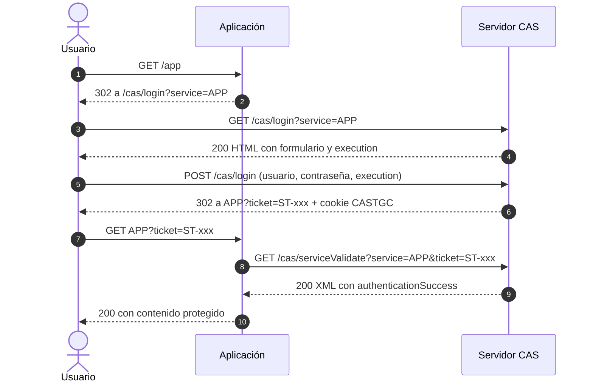

# Documentacion API CAS (Junta de Andalucía)

> ⚠️ **Aviso importante**
>
> Esta documentación **no es oficial**. El protocolo CAS es un estándar público (Apereo CAS 3.0), pero la implementación concreta de la Junta de Andalucía (`edea.juntadeandalucia.es`) no está documentada públicamente. Los detalles aquí recogidos provienen de ingeniería inversa del tráfico de las aplicaciones oficiales (iPasen, Moodle) y de la especificación oficial del protocolo.
>
> El uso de este flujo desde aplicaciones de terceros debe respetar los términos de servicio de la Junta de Andalucía. **Úsalo bajo tu responsabilidad y solo para uso personal o educativo.**

---

## Índice

1. [Información general](#información-general)
2. [Autenticación](#autenticación)
3. [Cabeceras comunes](#cabeceras-comunes)
4. [Formato de respuesta](#formato-de-respuesta)
5. [Endpoints](#endpoints)
   - [`GET /cas/login`](#get-caslogin)
   - [`POST /cas/login`](#post-caslogin)
   - [`GET /cas/serviceValidate`](#get-casservicevalidate)
   - [`GET /cas/logout`](#get-caslogout)
6. [Modelo de tickets](#modelo-de-tickets)
7. [Modelos de datos](#modelos-de-datos)
8. [Errores conocidos](#errores-conocidos)

---

## Información general

| Propiedad | Valor |
|-----------|-------|
| **Servidor CAS** | `https://edea.juntadeandalucia.es/cas` |
| **Protocolo** | CAS 3.0 (compatible con 1.0 y 2.0) |
| **Autenticación** | Formulario HTML (`username` + `password` + `execution`) |
| **Token de formulario** | `execution` (oculto en el HTML del login) |
| **Cookie de sesión SSO** | `CASTGC` (Ticket Granting Cookie) |
| **Ticket de servicio** | `ST-*` (Service Ticket), de un solo uso |
| **Validación** | `GET /cas/serviceValidate?service=...&ticket=ST-...` |
| **Formato de validación** | XML (por defecto) o JSON (si se solicita) |
| **Servicios protegidos** | Moodle Centros, iPasen (vía IdEA), Secretaría Virtual |

---

## Autenticación

El CAS es un protocolo de **Single Sign-On (SSO) basado en tickets**. No es una API REST al uso: requiere una secuencia de peticiones (GET → POST → validación) que se describe a continuación.



**Puntos clave**

| Concepto | Descripción |
|----------|-------------|
| **`service`** | URL de la aplicación a la que se quiere acceder. Debe ir **URL-encoded**. |
| **`execution`** | Token oculto en el formulario HTML que CAS genera para cada sesión de login. Sin él, el `POST` es rechazado. |
| **`CASTGC`** | Ticket Granting Cookie. Mantiene la sesión SSO. Una vez autenticado, el usuario no necesita volver a introducir credenciales para otros servicios del mismo CAS. |
| **`ST`** | Service Ticket. De **un solo uso** y de vida corta. La aplicación lo valida contra CAS y lo descarta. |

---

## Cabeceras comunes

Todas las peticiones del flujo deben llevar:

```
Content-Type: application/x-www-form-urlencoded
User-Agent: <el de tu app>
```

El `User-Agent` no se valida de forma estricta en el CAS de la Junta. Sin embargo, se recomienda enviar un `User-Agent` identificable y coherente.

La cookie `CASTGC` se obtiene tras el `POST /cas/login` y **debe** reenviarse en las peticiones posteriores a otros servicios del mismo CAS para mantener la sesión SSO.

---

## Formato de respuesta

El CAS no usa un envelope JSON único. El formato depende del endpoint y de la versión del protocolo:

| Versión | Endpoint | Cuerpo de respuesta |
|---------|----------|---------------------|
| CAS 1.0 | `/cas/validate` | Texto plano: `yes\nUSUARIO` (éxito) o `no\n` (fallo). |
| CAS 2.0 | `/cas/serviceValidate` | XML con `<cas:authenticationSuccess>` o `<cas:authenticationFailure>`. |
| CAS 3.0 | `/cas/serviceValidate?format=JSON` | JSON con `serviceResponse.authenticationSuccess` o `serviceResponse.authenticationFailure`. |

> **Importante:** `serviceValidate` **siempre devuelve HTTP 200**, incluso cuando el ticket es inválido. La aplicación debe parsear el cuerpo y comprobar si existe `authenticationSuccess` o `authenticationFailure`.

---

## Endpoints

### `GET /cas/login`

Solicita el formulario de login. Es el primer paso del flujo.

**Query params**

| Parámetro | Ejemplo | Descripción |
|-----------|---------|-------------|
| `service` | `https%3A%2F%2Feducacionadistancia...` | URL de la aplicación a la que se quiere acceder, **URL-encoded**. |

**Ejemplo real (Junta de Andalucía)**

```
GET https://edea.juntadeandalucia.es/cas/login?service=https%3A%2F%2Feducacionadistancia.juntadeandalucia.es%2Fcentros%2Fcordoba%2Flogin%2Findex.php%3FauthCAS%3DCAS
```

**Respuesta 200**

Devuelve un **HTML** con el formulario de login. Dentro del HTML hay un `<input type="hidden" name="execution" value="...">` que es **obligatorio** incluir en el `POST`.

```html
<form method="POST" action="/cas/login?service=...">
  <input type="text" name="username" />
  <input type="password" name="password" />
  <input type="hidden" name="execution" value="e1s1_..." />
  <input type="hidden" name="_eventId" value="submit" />
  <button type="submit">Iniciar sesión</button>
</form>
```

**Campos clave**

| Campo | Descripción |
|-------|-------------|
| `input[name=execution]` | Token obligatorio para el `POST /cas/login`. |
| `input[name=_eventId]` | Siempre `submit`. |
| `action` | URL del `POST` (incluye el `service` URL-encoded). |

**Extraer `execution` en Android/Kotlin**

```kotlin
private fun extractExecution(html: String): String? {
    val inputRe = Regex("""<input\b[^>]*>""", RegexOption.IGNORE_CASE)
    val nameRe  = Regex("""name\s*=\s*["']execution["']""", RegexOption.IGNORE_CASE)
    val valueRe = Regex("""value\s*=\s*["']([^"']*)["']""", RegexOption.IGNORE_CASE)
    return inputRe.findAll(html).map { it.value }
        .firstOrNull { nameRe.containsMatchIn(it) }
        ?.let { valueRe.find(it)?.groupValues?.get(1) }
}
```

---

### `POST /cas/login`

Envía las credenciales y el `execution` para autenticar al usuario.

**Headers**

```
Content-Type: application/x-www-form-urlencoded
User-Agent: <el de tu app>
```

**Body (form-urlencoded)**

| Campo | Tipo | Obligatorio | Descripción |
|-------|------|-------------|-------------|
| `username` | string | ✅ | Usuario (NIF/NIE/IdEA). |
| `password` | string | ✅ | Contraseña. |
| `execution` | string | ✅ | Token extraído del HTML del `GET /login`. |
| `_eventId` | string | ✅ | Siempre `submit`. |

**Respuesta 302 (éxito)**

```
HTTP/1.1 302 Found
Location: https://<app>?ticket=ST-12345678-abcdefgh
Set-Cookie: CASTGC=TGT-12345678-...; Path=/cas/; Secure; HttpOnly
```

**Campos clave**

| Campo | Descripción |
|-------|-------------|
| `Location` | Contiene el **Service Ticket (`ST-*`)**. |
| `Set-Cookie: CASTGC` | Contiene el **Ticket Granting Cookie**, que mantiene la sesión SSO. |

**Respuesta 302 (fallo — credenciales incorrectas)**

```
HTTP/1.1 302 Found
Location: /cas/login?service=...&error=true
```

> ⚠️ CAS **no devuelve un error HTTP** en caso de credenciales incorrectas: redirige de vuelta al login con `?error=true`. La aplicación debe inspeccionar el `Location` para saber si el login ha tenido éxito.

> 💡 **Sobre el `CASTGC`:** esta cookie es la clave de la sesión SSO. Una vez obtenida, el usuario puede acceder a **cualquier otro servicio** del mismo CAS sin volver a introducir credenciales. Guárdala con cuidado.

---

### `GET /cas/serviceValidate`

Valida el Service Ticket contra el servidor CAS. **Es el paso que confirma al usuario**.

**Query params**

| Parámetro | Ejemplo | Descripción |
|-----------|---------|-------------|
| `service` | `https%3A%2F%2F...` | La misma URL que se usó en el `GET /login` (URL-encoded). |
| `ticket` | `ST-12345678-abcdefgh` | El `ST-*` recibido en el `Location` tras el `POST /login`. |
| `format` | `JSON` | Opcional. Si se indica, devuelve JSON en vez de XML. |

**Ejemplo**

```
GET https://edea.juntadeandalucia.es/cas/serviceValidate?service=https%3A%2F%2F...&ticket=ST-12345678-abcdefgh
```

**Respuesta 200 (éxito)**

Devuelve un **XML** (por defecto) con la identidad del usuario:

```xml
<cas:serviceResponse xmlns:cas="http://www.yale.edu/tp/cas">
  <cas:authenticationSuccess>
    <cas:user>USUARIO</cas:user>
    <cas:attributes>
      <cas:attribute name="displayName" value="Nombre Apellido" />
      <cas:attribute name="email" value="usuario@..." />
    </cas:attributes>
  </cas:authenticationSuccess>
</cas:serviceResponse>
```

**Respuesta 200 (fallo — ticket inválido o caducado)**

```xml
<cas:serviceResponse xmlns:cas="http://www.yale.edu/tp/cas">
  <cas:authenticationFailure code="INVALID_TICKET">
    Ticket ST-12345678-abcdefgh not recognized
  </cas:authenticationFailure>
</cas:serviceResponse>
```

**Campos clave**

| Campo | Descripción |
|-------|-------------|
| `cas:user` | Identidad del usuario autenticado. |
| `cas:attributes` | Atributos adicionales (nombre, email, etc.). |
| `cas:authenticationFailure.code` | Código de error (`INVALID_TICKET`, `INVALID_SERVICE`...). |

**Respuesta 200 con `format=JSON`**

```
GET /cas/serviceValidate?service=...&ticket=...&format=JSON
```

```json
{
  "serviceResponse": {
    "authenticationSuccess": {
      "user": "USUARIO",
      "attributes": {
        "displayName": "Nombre Apellido",
        "email": "usuario@..."
      }
    }
  }
}
```

> 💡 Para obtener JSON en lugar de XML, añade `&format=JSON` a la URL.

---

### `GET /cas/logout`

Cierra la sesión SSO del usuario. **Invalida el `CASTGC`** y, por tanto, todas las sesiones activas en cualquier servicio del CAS.

**Query params**

| Parámetro | Ejemplo | Descripción |
|-----------|---------|-------------|
| `service` | `https%3A%2F%2Fmiapp.com` | Opcional. URL a la que redirigir tras el logout. Si no se indica, CAS muestra una página de confirmación. |

**Ejemplo**

```
GET https://edea.juntadeandalucia.es/cas/logout?service=https%3A%2F%2Fmiapp.com
```

**Respuesta 302**

```
HTTP/1.1 302 Found
Location: https://miapp.com
Set-Cookie: CASTGC=; Max-Age=0; Path=/cas/
```

> ⚠️ **El logout del CAS no cierra la sesión de la aplicación**. Solo invalida el `CASTGC`. La aplicación debe gestionar su propia sesión (borrar su cookie de sesión) por separado.

---

## Modelo de tickets

| Ticket | Formato | Vida útil | Propósito |
|--------|---------|-----------|-----------|
| **TGT** (Ticket Granting Ticket) | `TGT-*` | Sesión SSO (horas) | Mantener la sesión SSO. Se almacena en la cookie `CASTGC`. |
| **ST** (Service Ticket) | `ST-*` | Segundos (un solo uso) | Identificar al usuario ante un servicio concreto. |
| **PGT** (Proxy Granting Ticket) | `PGT-*` | Sesión | Solo para autenticación proxy (poco habitual). |
| **PT** (Proxy Ticket) | `PT-*` | Segundos | Solo para autenticación proxy. |
| **LT** (Login Ticket) | `LT-*` | Minutos | Token interno del formulario de login (el `execution`). |

**Ciclo de vida del ST**

1. Se genera tras un `POST /login` exitoso.
2. Se entrega en el `Location` de la redirección (`?ticket=ST-...`).
3. La aplicación lo valida contra `/serviceValidate`.
4. **Se invalida inmediatamente** después de la validación. **No se puede reutilizar**.

---

## Modelos de datos

### Sesión CAS

```kotlin
data class CasSession(
    val castgc: String,
    val serviceTicket: String,
    val user: String?,
)
```

### Respuesta de validación (XML)

```kotlin
data class CasServiceResponse(
    val authenticationSuccess: CasAuthenticationSuccess?,
    val authenticationFailure: CasAuthenticationFailure?,
)

data class CasAuthenticationSuccess(
    val user: String,
    val attributes: Map<String, String>,
)

data class CasAuthenticationFailure(
    val code: String,
    val message: String,
)
```

### Respuesta de validación (JSON)

```kotlin
data class CasServiceResponseJson(
    val serviceResponse: CasServiceResponse,
)
```

---

## Errores conocidos

| Código (en XML/JSON) | Significado | Causa típica |
|----------------------|-------------|--------------|
| `INVALID_REQUEST` | Parámetros incorrectos o ausentes. | Falta `service` o `ticket`. |
| `INVALID_TICKET` | El ticket no existe o ha caducado. | El ST ya se usó, o han pasado demasiados segundos. |
| `INVALID_SERVICE` | El `service` no coincide con el del ticket. | Se cambió la URL de servicio entre el login y la validación. |
| `INVALID_TICKET_SPEC` | El ticket no tiene el formato esperado. | El ticket no empieza por `ST-`. |

> **En el `POST /login`:** las credenciales incorrectas **no** devuelven un error de validación; redirigen a `/cas/login?error=true`.
